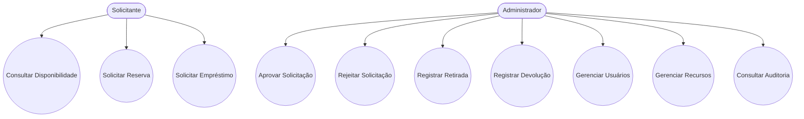
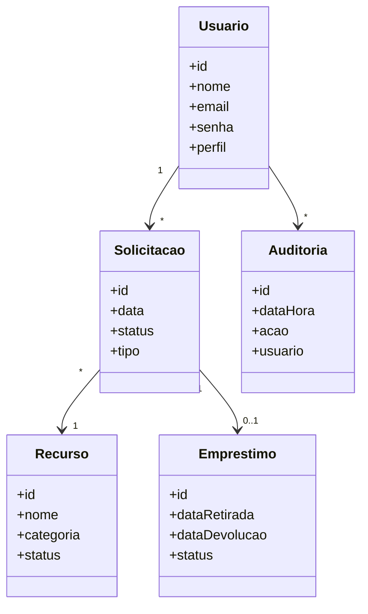

# SIGER - Sistema Integrado de Gestão de Empréstimos e Reservas

> Projeto desenvolvido para a disciplina de **Análise Orientada a Objetos e Projeto Arquitetural**.

## 📖 Sobre o Projeto

O **SIGER (Sistema Integrado de Gestão de Empréstimos e Reservas)** é uma solução destinada ao gerenciamento de recursos institucionais, permitindo o controle centralizado de reservas, empréstimos, devoluções e auditoria de equipamentos e ambientes.

Atualmente, muitas instituições realizam esse processo manualmente através de planilhas e registros dispersos, o que aumenta a ocorrência de conflitos de agendamento, perdas de controle e dificuldades de rastreamento.

O SIGER foi projetado para automatizar e organizar esse processo, garantindo maior eficiência, segurança e rastreabilidade.

---

## 🎯 Objetivos

- Centralizar a gestão dos recursos institucionais.
- Controlar empréstimos e reservas.
- Reduzir conflitos de agendamento.
- Garantir rastreabilidade das operações.
- Facilitar auditorias e aplicação de penalidades.

---

## 🏢 Recursos Gerenciados

O sistema permitirá o gerenciamento dos seguintes recursos:

- 💻 Notebooks
- 📱 Tablets
- 📽️ Projetores
- 📷 Câmeras
- 🏫 Laboratórios
- 🏢 Salas de Reunião

---

# 👥 Atores do Sistema

## Solicitante

Representa:

- Alunos
- Professores
- Colaboradores

Responsável por:

- Consultar disponibilidade
- Solicitar reservas
- Solicitar empréstimos

---

## Administrador

Responsável por:

- Aprovar solicitações
- Rejeitar solicitações
- Gerenciar usuários
- Gerenciar recursos
- Controlar retiradas e devoluções
- Aplicar penalidades
- Consultar auditorias

---

# ✅ Requisitos Funcionais

## RF01 - Gerenciar Usuários

O sistema deve permitir:

- Cadastro de usuários
- Alteração de dados
- Inativação de usuários
- Definição de perfis de acesso

### Critérios de Aceitação

- Criar usuários
- Atualizar usuários
- Inativar usuários
- Associar perfis

---

## RF02 - Consultar Disponibilidade de Recursos

O sistema deve permitir verificar a disponibilidade de recursos em datas e horários específicos.

### Critérios de Aceitação

- Exibir recursos disponíveis
- Exibir recursos indisponíveis
- Filtrar por período

---

## RF03 - Solicitar Reserva de Recursos

O sistema deve permitir registrar reservas de recursos institucionais.

### Critérios de Aceitação

- Selecionar recurso
- Informar período
- Registrar solicitação

---

## RF04 - Solicitar Empréstimo de Equipamentos

O sistema deve permitir solicitar empréstimos de equipamentos.

### Critérios de Aceitação

- Escolher equipamento
- Informar período de uso
- Gerar protocolo

---

## RF05 - Avaliar Solicitações

O administrador deve poder aprovar ou rejeitar solicitações.

### Critérios de Aceitação

- Aprovar solicitação
- Rejeitar solicitação
- Registrar justificativa

---

## RF06 - Controlar Retirada e Devolução

O sistema deve registrar a entrega e a devolução dos recursos.

### Critérios de Aceitação

- Registrar retirada
- Registrar devolução
- Atualizar status

---

## RF07 - Gerenciar Penalidades

O sistema deve controlar atrasos e aplicar penalidades.

### Critérios de Aceitação

- Detectar atraso
- Registrar penalidade
- Bloquear novas solicitações quando necessário

---

## RF08 - Registrar Auditoria e Histórico

O sistema deve armazenar o histórico das ações realizadas.

### Critérios de Aceitação

- Registrar data e hora
- Registrar usuário responsável
- Consultar histórico

---

# 🔒 Requisitos Não Funcionais

| Código | Descrição |
|----------|----------|
| RNF01 | Responder consultas em até 3 segundos |
| RNF02 | Utilizar autenticação por login e senha |
| RNF03 | Disponibilidade mínima de 99% |
| RNF04 | Interface responsiva e intuitiva |
| RNF05 | Registro completo para auditoria |

---

# 📋 Diagrama de Casos de Uso

---

# 📊 Diagrama de Classes

---

# 🏛️ Justificativa dos Atores

O modelo foi simplificado para utilizar apenas dois atores:

### Solicitante

Representa qualquer usuário que deseja reservar ou emprestar recursos.

### Administrador

Representa o responsável por todas as operações administrativas do sistema, incluindo aprovações, gestão de recursos, auditoria e penalidades.

Essa abordagem reduz a complexidade do modelo sem comprometer os requisitos de negócio.

---

# 📌 Conclusão

O SIGER foi projetado para oferecer uma solução centralizada para controle de recursos institucionais, permitindo gerenciamento eficiente de reservas, empréstimos, auditorias e penalidades.

A proposta busca aumentar a organização operacional, reduzir conflitos de uso dos recursos e melhorar a rastreabilidade das informações dentro da instituição.
